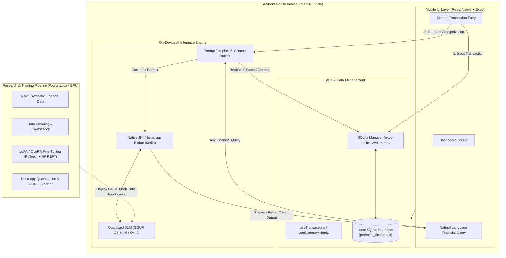

# System Architecture: SLM-Powered Personal Finance Assistant

## 1. Executive Overview

The **SLM-Powered Personal Finance Assistant** is a privacy-first, on-device mobile AI system designed for Android. All sensitive financial records and conversational AI processing remain strictly inside the user's mobile device, eliminating cloud exposure and preserving complete financial confidentiality.

---

## 2. Component Specifications

### 2.1 Mobile Application (`mobile/`)
- **Framework**: React Native with Expo SDK 52.
- **Language**: TypeScript with strict mode enabled (`"strict": true`).
- **Currency & Localization**: Indian Rupee (`INR` - `₹`) default, utilizing the `en-IN` grouping system (`₹450`, `₹12,500`, `₹1,50,000`, `₹10,00,000`) across all ledger displays, charts, and queries.
- **Data Persistence**: `expo-sqlite` utilizing SQLite WAL (Write-Ahead Logging) mode for concurrent read/write transactions and data durability.
- **On-Device Inference Integration**:
  - In development/initial phase: Modular abstraction interface (`IModelInferenceService`).
  - In production Android build: `llama.cpp` mobile runtime running GGUF-quantized models via native JNI Kotlin wrappers.

### 2.2 Model Development Pipeline (`model/`)
- **Base SLM Architectures Evaluated**:
  - Llama-3.2 (1B / 3B)
  - Qwen2.5 (0.5B / 1.5B / 3B)
  - SmolLM2 (1.7B)
  - Phi-3.5-mini (3.8B)
- **Fine-Tuning Stack**: PyTorch 2.x, Hugging Face `transformers`, `peft` (LoRA/QLoRA), and `trl` (`SFTTrainer`).
- **Quantization Target**: GGUF format with 4-bit quantization (`Q4_K_M` or `Q4_0`) to achieve inference speeds >10 tokens/sec on mobile ARM64 CPUs with memory footprint < 1.8 GB.

---

## 3. Data & Privacy Invariants

1. **Zero Cloud Telemetry**: Absolutely no financial transactions, budgets, or prompt contents are dispatched to external cloud servers, third-party analytics, or commercial LLM APIs.
2. **Local Data Ownership**: All records reside within the app's sandboxed SQLite database file (`personal_finance.db`).
3. **Cold-Start Capability**: The application and categorization logic function 100% offline without requiring internet access.
